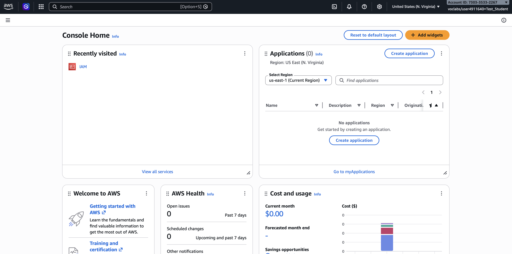
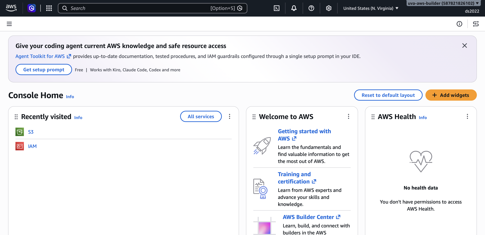
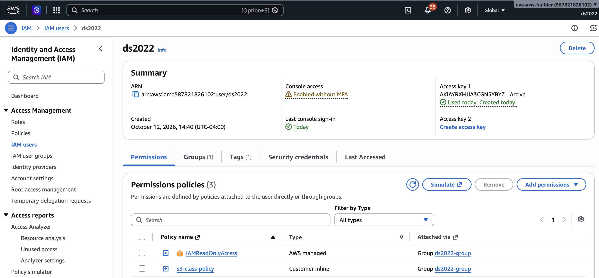

# AWS IAM and S3 Storage

The goal of this activity is to familiarize you with Amazon Identity Access & Management (IAM) and Amazon S3 storage. IAM is the central service that controls access to all other AWS services, so it is critical to have a basic understanding of how it works. S3 is one of the quintessential solutions for storing datasets, sharing files, backing up data, and building data pipelines that require reliable object storage.

You will learn how to use the web-based `AWS Management Console` and programmatically interact with AWS services via the `AWS Command Line tools` (awscli) and `boto3` Python package.

> **Note:** Work through the examples below, experimenting with each command and its various options. If you encounter an error message, don't be discouraged. Reach out to us for help when needed, and help each other when you can. 

- Start with the **In-class Exercises** which provide an introduction to IAM and S3.
  - Tuesday: IAM
  - Thursday: S3
- These exercises will provide you with the foundations to complete `Lab 6: Working with S3 Storage` (see Canvas assignment).
- **Optional:** Work through the **Advanced Concepts** if you wish to explore cloud storage in more depth.


## In-class exercises

This week's hands-on work has two parts, **Amazon IAM** and **Amazon S3**.

### IAM

#### Step 1: Log into AWS Academy

1. You should have received an email to your UVA account with an invitation to the AWS Academy Cloud Foundations course.
2. If you haven't done so yet, follow the [AWS Academy account setup](../../setup/aws_academy.md) instructions to get your account ready.

#### Step 2: Review AWS Academy lab instruction

1. On the AWS Academy Canvas page, navigate to the `DS2022 - AWS Cloud Foundations` course > `Modules` > `Introduction` and review the `How to complete lab exercises` instructions.

#### Step 3: Complete **Lab: Introduction to AWS IAM**

1. On the AWS Academy Canvas page, navigate to `Modules` > `Module 4` > `Lab - 1 Introduction to AWS IAM`
2. Follow the lab instructions. When you click **Start Lab**, wait until the AWS indicator light turns green.
3. Click on the AWS link when the indicator turns green. A new browser tab should open with the `AWS Management Console`.
  
4. Submit your work in AWS Academy.
5. End the AWS Academy lab.

#### Step 4: Access AWS Management Console for ds2022

The course AWS account uses the IAM user `ds2022`. Let's review that account setup in IAM via the AWS Management Console.

1. Open the [AWS Console URL](https://587821826102.signin.aws.amazon.com/console) and login with the `IAM Username` and `Password` provided in `DS2022_AWS_RDS_Credentials.txt`  (posted in Canvas > Modules > Week 08).
2. After logging in, you should see a screen like this:



3. Click on `IAM` to open the Identity & Access Management page.
4. Click on `Users`.
5. Click on `ds2022`.
  
6. On the `Permissions` tab, note the Permission policies granting:
  - IAMReadOnlyAccess
  - s3-class-policy

Well done!

### S3

#### Environment

The following exercises require a working Python 3 environment, the AWS CLI, and `boto3`. You will install the tools next, then configure access keys in the following section.

1. Create a new folder and set up a new Python environment:
  ```bash
  mkdir -p ~/ds2022-fall-26/s3
  cd ~/ds2022-fall-26/s3
  uv init 
  ```
2. AWS CLI and Python packages
  We need two packages, installed in two different ways:
  - `awscli`: provides AWS CLI tools
  - `boto3`: package to connect to AWS in your Python scripts
  The AWS CLI is a command line tool, not a library your scripts import, so install it as a `uv` tool. That makes the `aws` command available in every terminal, independent of any project environment:
  ```bash
  uv tool install awscli
  ```
  `boto3` is imported by your Python scripts, so add it to the project:
  ```bash
  uv add boto3
  ```
  Confirm with
  ```bash
  aws --version
  uv tree
  uv run python -c "import boto3"
  ```
  If the shell reports `aws: command not found`, run `uv tool update-shell`, then open a new terminal so the `uv` tool directory is on your `PATH`.


#### AWS CLI configuration

You are set up as user `ds2022` in AWS. Your credentials are posted in Canvas (`DS2022 > Modules > Week 08`) in the `DS2022_AWS_RDS_Credentials.txt` file. Look them up now. You will need:

- AWS_ACCESS_KEY
- AWS_SECRET_ACCESS_KEY

> **It is highly advised NOT to use root credentials for access in this way.**

In the terminal, follow these steps to configure the `aws` command line tools:

```bash
aws configure
```

You will be prompted to enter:

- **AWS Access Key ID**: Enter the Access Key ID (from Canvas)
- **AWS Secret Access Key**: Enter the Secret Access Key (from Canvas)
- **Default region name**: Enter your preferred AWS region (use `us-east-1`, you generally want to choose the one that's geographically closest)
- **Default output format**: Enter `json` (recommended) or `text` or `table`

The AWS account you enter in these steps must have at least read permission to access the resources you want to download. 

Upon completion of `aws configure` you will see a hidden directory `~/.aws`. 

> **Note:** Remember, the creation of personal config files in hidden directories inside your home directory is a best-practice pattern. 

**Check the config file**

You can verify your AWS configuration by viewing the config file:

```bash
cat ~/.aws/config
cat ~/.aws/credentials
```

Or test your configuration by running:

```bash
aws sts get-caller-identity
```

This command will display in JSON format the associated AWS account ID, user ARN, and user ID, confirming that your credentials are working correctly.

It should look similar to this:

```json
{
    "UserId": "xxxxxxxxxxxxx",
    "Account": "nnnnnnnnnnnnnnn",
    "Arn": "arn:aws:iam::nnnnnnnnnnnnn:user/ds2022"
}
```


#### Access S3 using the AWS CLI

Now we can get busy!

#### `aws s3 ls` - List Buckets

```
aws s3 ls
```

You should see a list similar to this

```
2026-03-17 14:01:15 ds2022-fall26
2026-03-17 14:09:13 ds2022-khs3z
...
```

#### `aws s3 mb` - Make a new bucket

```
echo $USER
aws s3 mb s3://class-$USER
```

The $USER variable will be expanded to your computing id. We use it here to allow everyone to create separate buckets without naming conflicts. You should see a response like:

```
make_bucket: class-mst3k
```

Remember that S3 bucket names must be globally unique from all other AWS customers. If you receive an error that the bucket already exists, retry with a new name, e.g. class-$USER-1, class-$USER-2, etc..

Check the list of buckets again:
```
aws s3 ls
```
Your bucket should be in the list now. 

If the output is too long, pipe it into grep, like `aws s3 ls | grep $USER`.

**Optional:** Log into the AWS Management Console. **The URL and credentials are in Canvas > Modules > Week 08**. Search for `S3` and click on `General Purpose Buckets`.


#### `aws s3 cp` - Copy files

The syntax is `aws s3 cp SOURCE DESTINATION`, similar to the regular `cp` command you're familiar with already. You can copy between any source/destination so long as at least one of them is S3:

- Copy from local environment to S3
- Copy from S3 to local environment
- Copy from S3 bucket to another S3 bucket

**Download**, try this:
```
aws s3 cp s3://ds2022-fall26/cloud.jpg .
```
This downloads `cloud.jpg` from the S3 bucket `ds2022-fall26` to your computer. Remember, `.` is the shorthand for your current directory.

**Upload** (set content type so a later `presign` URL displays in the browser):
```
aws s3 cp cloud.jpg s3://class-$USER/folder/in/bucket/cloud.jpg --content-type image/jpeg
```
Copies `cloud.jpg` into your bucket under the key `folder/in/bucket/cloud.jpg` (same path the Python scripts use). Confirm with `aws s3 ls s3://class-$USER --recursive`.

Create another file on your computer, like `hello.txt`, add a message and save it. Then upload it into a new folder in S3.

**Another upload:**
```
aws s3 cp hello.txt s3://class-$USER/new_folder/hello.txt
```
Notice that we don't have to create the `new_folder`.

**Folders in S3:** Contrary to how it appears, S3 is not a file system in the ordinary sense. It is object storage: each object has a **key** (name) and a **value** (the file contents). Keys can include `/`, which looks like folders (for example `folder/subfolder/filename.txt`), but those “folders” are only a naming convention—a mental convenience—not real directories you create ahead of time. The bucket name is not part of the key.

#### `aws s3 ls` - List the contents of a bucket

In the example below, replace `class-mst3k` with your actual bucket name.

```
aws s3 ls s3://class-mst3k/
                           PRE folder/
                           PRE new_folder/
```

`PRE folder/` and `PRE new_folder/` are the CLI’s way of showing key prefixes (the “folders”) after your uploads. Use `aws s3 ls s3://class-mst3k/ --recursive` to see full keys such as `folder/in/bucket/cloud.jpg`.

#### `aws s3 sync` - Synchronize a folder

`cp` copies one object. `sync` copies a whole prefix (folder) and only transfers what is missing or changed. The shared course bucket has a read-only `data/` folder you can pull from.

**1. Sync from the course bucket to your computer**

```bash
mkdir -p data
aws s3 sync s3://ds2022-fall26/data/ ./data/
ls data
```

**2. Sync that folder up into your own bucket**

```bash
aws s3 sync ./data/ s3://class-$USER/data/
aws s3 ls s3://class-$USER/data/
```

You can sync in any direction as long as at least one side is S3 (local ↔ S3, or S3 ↔ S3).

#### `aws s3 mv` - Move (rename) an object in your bucket

`mv` renames or relocates an object. Practice on a file you just synced into your bucket (pick a real filename from `aws s3 ls s3://class-$USER/data/`):

```bash
aws s3 mv s3://class-$USER/data/notes.txt s3://class-$USER/data/readme.txt
aws s3 ls s3://class-$USER/data/
```

If `notes.txt` is not in that listing, use another name from the list.

#### `aws s3 presign` - Presign an S3 URL

In some cases you want to share a file for a limited time without creating access keys. `presign` creates a signed URL that expires after a set number of seconds (`--expires-in`).

```bash
aws s3 presign --expires-in 600 s3://class-$USER/folder/in/bucket/cloud.jpg
```

You will receive a URL like this (yours will differ):

```text
https://class-mst3k.s3.amazonaws.com/folder/in/bucket/cloud.jpg?AWSAccessKeyId=AKIA...&Signature=...&Expires=...
```

That URL works for 600 seconds (10 minutes). After it expires, the link no longer grants access; the object is still in your bucket.

If the browser downloads the file instead of showing the image, the object was stored without a JPEG content type. Re-upload with `--content-type image/jpeg`, or use `06-presign.py`, which sets `ResponseContentType` / `ResponseContentDisposition` so the image opens inline.

#### `aws s3 rm` - Remove files

**Delete a file**
```
aws s3 rm s3://class-$USER/new_folder/hello.txt
```

**Delete all files and folders in your bucket**
```
aws s3 rm --recursive s3://class-$USER
```

#### `aws s3 rb` - Delete bucket

**Delete the bucket itself** 
```
aws s3 rb s3://class-$USER
```

**Remember:** S3 buckets must be emptied of all contents before they can be removed. Once removed, the bucket name is available for other users.

### Access S3 using `boto3` in Python

The `boto3` package is the standard library enabling programmatic access to AWS using Python. `boto3` can access all AWS services and is helpful for creating,
managing, or removing remote resources and infrastructure dynamically. The steps below refer to using `boto3` for working with files in S3.

#### Install `boto3`

If you already ran `uv add boto3` in [Environment](#environment), you can skip this. If you skipped that section (or are in a different project folder), run:

```bash
uv add boto3
uv run python -c "import boto3"
```

#### Use `boto3`

By default, after you ran `aws configure`, `boto3` looks up credentials in `~/.aws/credentials` (and region settings in `~/.aws/config`). You do **not** need to pass keys into your code:

```python
import boto3

s3 = boto3.client('s3')
```

#### Optional: credentials via environment variables

If `~/.aws/credentials` is missing (or you prefer not to use it), you can set credentials in the shell as environment variables and read them in the script. That keeps secrets out of the source file—never hardcode keys in clear text (see [best practices](../../best-practices.md)).

In the shell:

```bash
export AWS_ACCESS_KEY_ID="YOUR_KEY"
export AWS_SECRET_ACCESS_KEY="YOUR_SECRET"
```

In Python:

```python
import os
import boto3

s3 = boto3.client(
    "s3",
    aws_access_key_id=os.getenv("AWS_ACCESS_KEY_ID"),
    aws_secret_access_key=os.getenv("AWS_SECRET_ACCESS_KEY"),
)
```

For class, prefer the default: configure once with `aws configure`, then use plain `boto3.client('s3')`.


#### Create a bucket

```python
import boto3

bucket_name = "class-mst3k"  # replace with your bucket name
s3 = boto3.client("s3", region_name="us-east-1")
# For most regions you pass CreateBucketConfiguration={"LocationConstraint": "region-name"}.
# us-east-1 is special: omit LocationConstraint or create_bucket will fail.
s3.create_bucket(Bucket=bucket_name)
```


#### Upload a file to S3

```python
import boto3

bucket_name = "class-mst3k"  # replace with your bucket name
local_file = "cloud.jpg"
key = "folder/in/bucket/cloud.jpg"  # same key as 04-upload-object.py / 06-presign.py

s3 = boto3.client("s3")
with open(local_file, "rb") as f:
    s3.put_object(
        Bucket=bucket_name,
        Key=key,
        Body=f,
        ContentType="image/jpeg",
    )
```


#### Download a file from S3

Shared course image (see also `03-download-object.py`):

```python
import boto3

bucket_name = "ds2022-fall26"
key = "cloud.jpg"
local_file = "cloud.jpg"
s3 = boto3.client("s3")

obj = s3.get_object(Bucket=bucket_name, Key=key)
# save the object, "wb" stands for write binary
with open(local_file, "wb") as f:
    f.write(obj["Body"].read())
```


#### Deleting files in S3

```python
import boto3

s3 = boto3.client("s3")
bucket_name = "class-mst3k"  # replace with your bucket name
key = "folder/in/bucket/cloud.jpg"

s3.delete_object(Bucket=bucket_name, Key=key)
```

To remove every object (empty the bucket), see `08-delete-all-objects.py`.


#### Delete a bucket

```python
import boto3

bucket_name = "class-mst3k"  # replace with your bucket name
s3 = boto3.client("s3")
s3.delete_bucket(Bucket=bucket_name)
```

> **Note:** Buckets have to be empty before they can be deleted (`08-delete-all-objects.py`, then `09-delete-bucket.py`).

#### Catching boto exceptions

Most S3 errors show up as a `botocore.exceptions.ClientError`. For the simplest demos above, we omit error handling so you can focus on the API calls.

See the numbered scripts in this folder for runnable examples, including `try` / `except ClientError` patterns:

#### Python scripts

| Script | Purpose |
|--------|---------|
| `00-env-credentials.py` | Build S3 client from env vars (optional; default is `~/.aws`) |
| `01-make-bucket.py` | Create `class-$USER` |
| `02-list-buckets.py` | List buckets |
| `03-download-object.py` | Download `cloud.jpg` from `s3://ds2022-fall26/` |
| `04-upload-object.py` | Upload to `folder/in/bucket/cloud.jpg` (`ContentType=image/jpeg`) |
| `05-list-objects.py` | List objects in a bucket |
| `06-presign.py` | Presign `folder/in/bucket/cloud.jpg` (inline display) |
| `07-delete-object.py` | Delete `folder/in/bucket/cloud.jpg` |
| `08-delete-all-objects.py` | Empty a bucket (recursive) |
| `09-delete-bucket.py` | Delete the bucket (must be empty) |

The scripts are short top-to-bottom demos—no helper functions or `if __name__ == "__main__"` guards—so each file is easy to read in one pass. For labs and production code, follow the course [best practices](../../best-practices.md).

## Advanced Concepts (Optional)


### IAM


#### Policies

Example (bucket policy that allows read-only access to everything in a bucket):

```json
{
  "Version": "2012-10-17",
  "Statement": [
    {
      "Effect": "Allow",
      "Principal": "*",
      "Action": ["s3:GetObject"],
      "Resource": "arn:aws:s3:::YOUR-BUCKET-NAME/*"
    }
  ]
}
```

Example (least-privilege IAM policy that only allows uploads to one prefix):

```json
{
  "Version": "2012-10-17",
  "Statement": [
    {
      "Effect": "Allow",
      "Action": ["s3:PutObject"],
      "Resource": "arn:aws:s3:::YOUR-BUCKET-NAME/book-analysis/*"
    }
  ]
}
```


#### AWS STS + temporary credentials

Example (conceptual flow):

- Create a role with an S3 policy attached.
- Call `sts:AssumeRole` to get temporary credentials.
- Use those temporary credentials in the AWS CLI or `boto3` instead of long-lived access keys.

**AWS CLI — one-off** `assume-role`

```bash
aws sts assume-role \
  --role-arn arn:aws:iam::123456789012:role/YOUR_ROLE_NAME \
  --role-session-name ds2022-session
```

The JSON output includes `AccessKeyId`, `SecretAccessKey`, and `SessionToken`. Export those as environment variables (or paste into a new shell) to run further `aws` commands as that role.

**AWS CLI — profile that assumes a role** (recommended)

Add to `~/.aws/config` (use your real account ID and role name; `source_profile` is the profile whose user may call `sts:AssumeRole`):

```text
[profile my-assumed-role]
role_arn = arn:aws:iam::123456789012:role/YOUR_ROLE_NAME
source_profile = default
region = us-east-1
```

Then:

```bash
aws s3 ls --profile my-assumed-role
```

The CLI calls STS for you when you use that profile.

**boto3 — explicit** `assume_role`

```python
import boto3

sts = boto3.client("sts")
resp = sts.assume_role(
    RoleArn="arn:aws:iam::123456789012:role/YOUR_ROLE_NAME",
    RoleSessionName="ds2022-session",
)
creds = resp["Credentials"]

s3 = boto3.client(
    "s3",
    aws_access_key_id=creds["AccessKeyId"],
    aws_secret_access_key=creds["SecretAccessKey"],
    aws_session_token=creds["SessionToken"],
)
print(s3.list_buckets())
```

**boto3 — same as the CLI profile**

If you defined `my-assumed-role` in `~/.aws/config` as above:

```python
import boto3

session = boto3.Session(profile_name="my-assumed-role")
s3 = session.client("s3")
print(s3.list_buckets())
```


#### Multiple AWS profiles

You can keep credentials for several AWS accounts and users side by side using named profiles in `~/.aws/credentials` and `~/.aws/config`.

Example (`~/.aws/credentials`):

```text
[default]
aws_access_key_id = YOUR_DEFAULT_ACCESS_KEY
aws_secret_access_key = YOUR_DEFAULT_SECRET_KEY

[ds2022]
aws_access_key_id = YOUR_DS2022_ACCESS_KEY
aws_secret_access_key = YOUR_DS2022_SECRET_KEY
```

Example (`~/.aws/config`):

```text
[default]
region = us-east-1

[profile ds2022]
region = us-east-1
```

Use a specific profile with the AWS CLI:

```bash
aws s3 ls --profile ds2022
```

And in `boto3`:

```python
import boto3

session = boto3.Session(profile_name="ds2022")
s3 = session.client("s3")
print(s3.list_buckets())
```


### S3


#### Versioning + lifecycle policies

Example (lifecycle rules are configured as bucket lifecycle JSON). Common patterns:

- Delete incomplete multipart uploads after N days.
- Expire objects in a prefix after N days.
- Transition objects to cheaper storage classes after N days.


#### S3 event notifications

Example (typical event-driven pipeline):

- S3 `ObjectCreated` event on a prefix (e.g., `book-analysis/`)
- Triggers one of: **Lambda**, **SQS**, or **SNS**
- Your handler reads the new object and runs processing


#### Access logging & auditing

Examples:

- **CloudTrail data events** for S3: see who accessed which objects (read/write).
- **S3 server access logs**: deliver access logs to a separate logging bucket for analysis.

#### Access control lists (ACLs)

An ACL is a per-object (or per-bucket) permission list—who can read or write that object. Newer accounts often have **Block Public Access** turned on, so public ACLs may be rejected until you change that setting (in class, prefer private objects + `presign` unless the lab asks for public access).

Upload with a canned ACL (example: public read):

```python
import boto3

bucket_name = "class-mst3k"  # replace with your bucket name
s3 = boto3.client("s3")

with open("cloud.jpg", "rb") as f:
    s3.put_object(
        Bucket=bucket_name,
        Key="folder/in/bucket/cloud.jpg",
        Body=f,
        ContentType="image/jpeg",
        ACL="public-read",
    )
```

Change the ACL on an existing object:

```python
s3.put_object_acl(
    Bucket=bucket_name,
    Key="folder/in/bucket/cloud.jpg",
    ACL="private",
)
```

Common canned ACLs: `private`, `public-read`. For broader rules (whole prefix, many principals), use a **bucket policy** instead (see IAM policies above).

## Resources

- [Amazon IAM - Getting started](https://docs.aws.amazon.com/IAM/latest/UserGuide/getting-started.html)
- [Amazon S3 - Getting started](https://docs.aws.amazon.com/AmazonS3/latest/userguide/GetStartedWithS3.html)
- [AWS CLI - Getting started](https://docs.aws.amazon.com/cli/latest/userguide/cli-chap-getting-started.html)
- [Boto3 Documentation](https://docs.aws.amazon.com/boto3/latest/)
- [Boto3 and S3](https://boto3.amazonaws.com/v1/documentation/api/latest/reference/services/s3.html)

