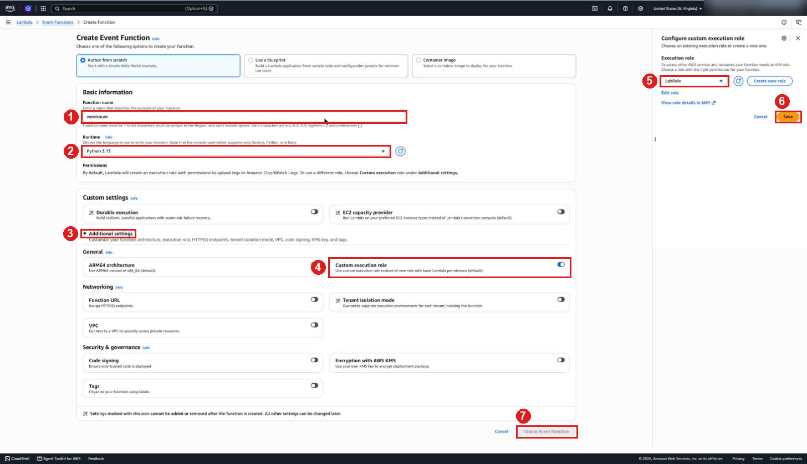
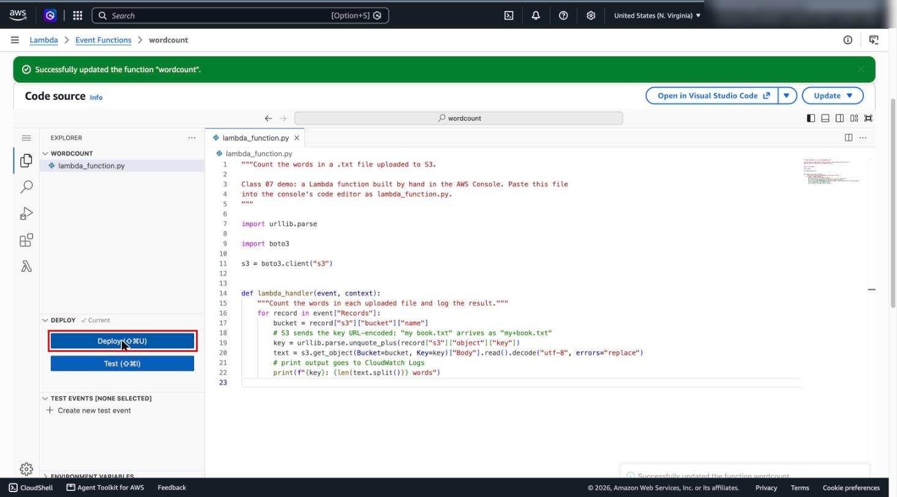
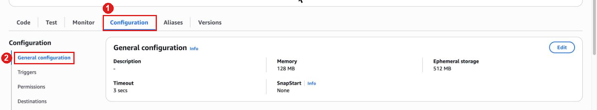
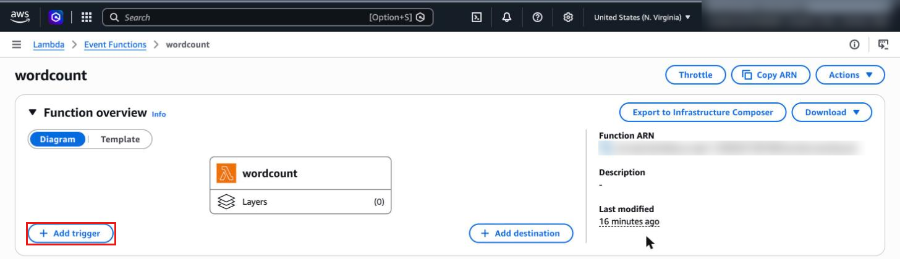
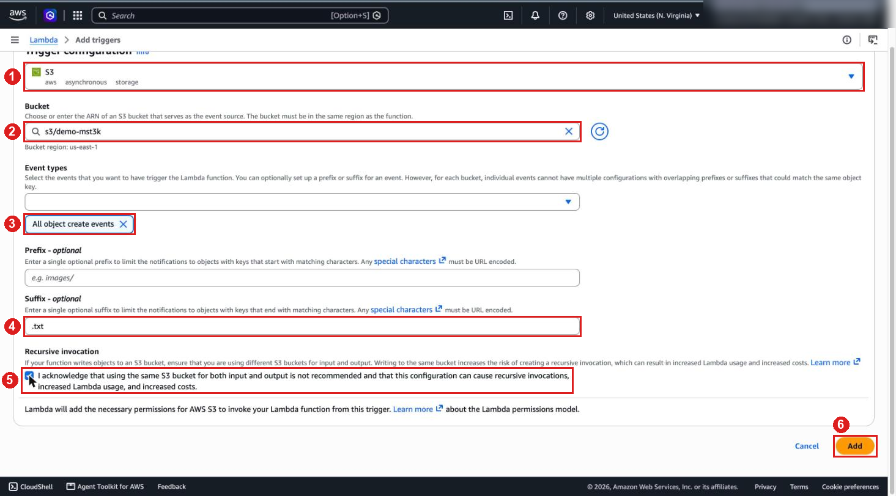
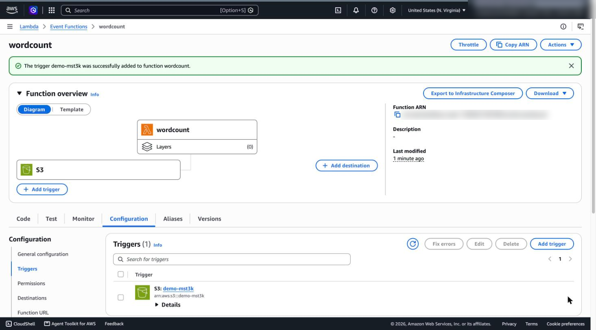
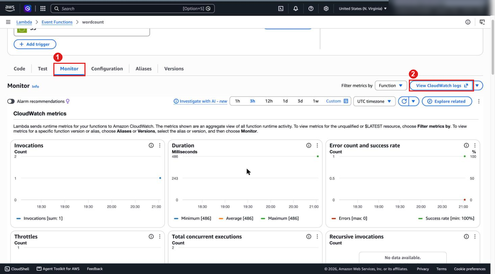
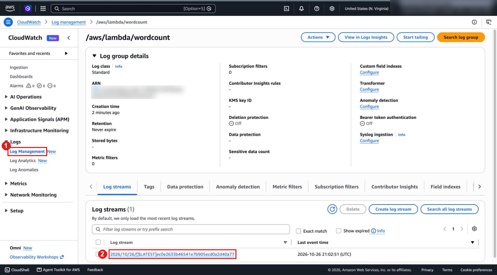
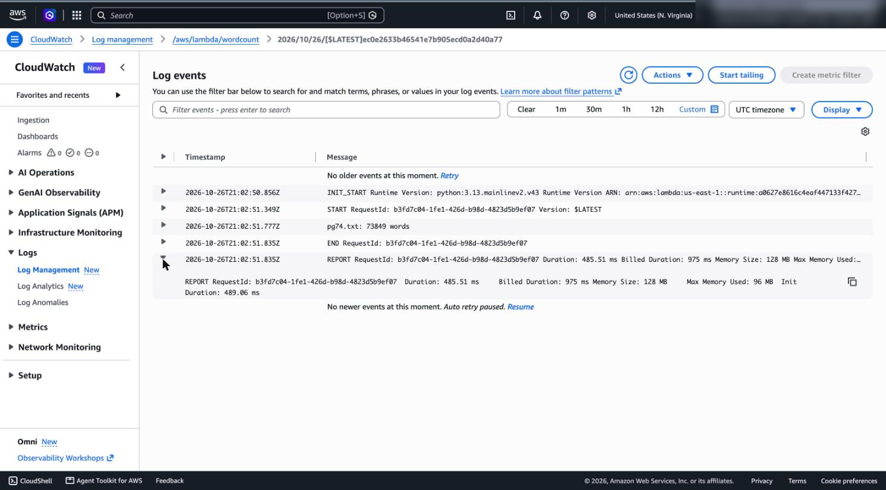

# A Lambda function in the AWS Console

Instructor demo, before Lab 07 Part 2: a word-count function for `.txt` uploads, built by hand in the console. Concepts: [class/07-lambda](../../class/07-lambda/README.md).

> [!IMPORTANT]
> Use a separate bucket, not `public-mst3k`. A second `.txt` trigger on the Lab 06 bucket makes `chalice deploy` fail.

## 0. Setup

1. On the **Learner Lab page**, click **Start Lab** and wait for the green **AWS** icon. See [Start the AWS Academy Learner Lab (class/06-s3)](../../class/06-s3/README.md#start-the-aws-academy-learner-lab).
2. Click **AWS Details** → **AWS CLI** → **Show**. Copy the block into `~/.aws/credentials` on your computer (credentials change with every lab session). Check with `aws sts get-caller-identity`.
3. Click the green **AWS** icon to open the AWS Console.

## 1. Create a bucket for the demo

```bash
aws s3 mb s3://demo-mst3k
```

## 2. Create the function

In the AWS Console, search for **Lambda** → **Event Functions** → **Create function** → **Author from scratch**:

| Field | Value |
| --- | --- |
| **Function name** | `wordcount` |
| **Runtime** | Python 3.13 |
| **Additional settings** → **Custom execution role** | turn on → **Execution role** `LabRole` → **Save** |



**Create Event Function**. If a **Getting started** pop-up appears, click **Dismiss**.

## 3. Add the code

Click the **Code** tab. In the inline code editor, delete all code and paste the code from [lambda_function.py](lambda_function.py). Click **Deploy**.



## 4. Look at memory and timeout

Click the **Configuration** tab. Under **General configuration**, confirm the **Memory** (128 MB) and **Timeout** (3 s) settings. That's enough here; Lab 07 uses 512 MB and 60 s.



## 5. Add the S3 trigger

Under **Function overview**, click **+ Add trigger**.



Under **Trigger configuration**, select **S3** as the source. Then complete the trigger configuration fields according to this table:

| Field | Value |
| --- | --- |
| **Bucket** | `demo-mst3k` |
| **Event types** | **All object create events** |
| **Suffix** | `.txt` |

Acknowledge **Recursive invocation** → **Add**.



Show the trigger in **Function overview**, **Configuration** → **Triggers**, and **S3** → `demo-mst3k` → **Properties** → **Event notifications**.



## 6. Upload a file

```bash
curl -sSo pg74.txt https://www.gutenberg.org/cache/epub/74/pg74.txt
aws s3 cp pg74.txt s3://demo-mst3k/
```

## 7. Check the CloudWatch logs

From the function: **Monitor** tab → **View CloudWatch logs** → newest log stream.



From CloudWatch: **CloudWatch** → **Logs** → **Log Management** → `/aws/lambda/wordcount` → newest log stream (`YYYY/MM/DD/[$LATEST]...`).





From the terminal:

```bash
aws logs filter-log-events --log-group-name /aws/lambda/wordcount --query 'events[].[message]' --output text
```

With AWS CLI v2 only (check with `aws --version`), the shorter `tail` command also works:

```bash
aws logs tail /aws/lambda/wordcount --since 10m
```

Expected:

```text
pg74.txt: 73849 words
REPORT RequestId: ... Duration: ... ms ... Max Memory Used: ... MB
```

No log after a minute: upload again (the first trigger on a bucket can take a few minutes).

## 8. Clean up

**Lambda** → **Functions** → `wordcount` → **Actions** → **Delete**.

```bash
aws s3 rb s3://demo-mst3k --force
aws logs delete-log-group --log-group-name /aws/lambda/wordcount
```

## Preview: the same steps with Chalice

In Lab 07, Part 2, a Chalice app creates the same pieces from code:

| Console (this demo) | Chalice (Lab 07, Part 2) |
| --- | --- |
| Execution role `LabRole` | `"iam_role_arn"`, `"manage_iam_role": false` in `.chalice/config.json` |
| `lambda_function.py`, `lambda_handler` | `app.py`, `chalicelib/analyze.py` |
| Memory and timeout | `"lambda_memory_size"`, `"lambda_timeout"` in `.chalice/config.json` |
| S3 trigger: bucket, event type, suffix | `@app.on_s3_event(bucket=BUCKET, events=["s3:ObjectCreated:*"], suffix=".txt")` |
| No packages | `requirements.txt`: `pymongo` |
| **Deploy** | `uv run chalice deploy` |
| **Monitor** → **View CloudWatch logs**, `aws logs filter-log-events` | `uv run chalice logs -n analyze_new_book` |
